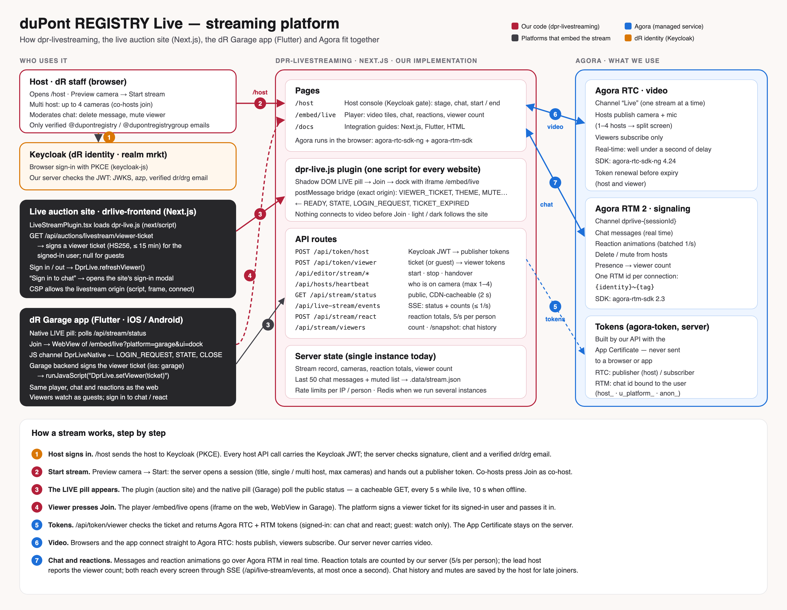

# Docs

The diagram's source is [architecture.svg](architecture.svg); edit it there, then re-export the PNG.

| Guide | For |
|---|---|
| [INTEGRATION-NEXTJS.md](INTEGRATION-NEXTJS.md) | A Next.js site (App or Pages Router). drlive-frontend is the worked example. |
| [INTEGRATION-FLUTTER.md](INTEGRATION-FLUTTER.md) | A Flutter app (dR Garage). A runnable sample is in [`../../flutter`](../../flutter/README.md). |
| [INTEGRATION-HTML.md](INTEGRATION-HTML.md) | Any website: one script tag. |
| [PLUGIN-API.md](PLUGIN-API.md) | `DprLive.*` API, events, messages, ticket format, theming. |
| [AUDIT.md](AUDIT.md) | The two prototypes this replaces, and what was fixed. |

The stream app also serves these guides at **`/docs`**, with the snippets filled with its own
origin and copy buttons. That page replaces the old "Embed & share" modal in `/host`.
